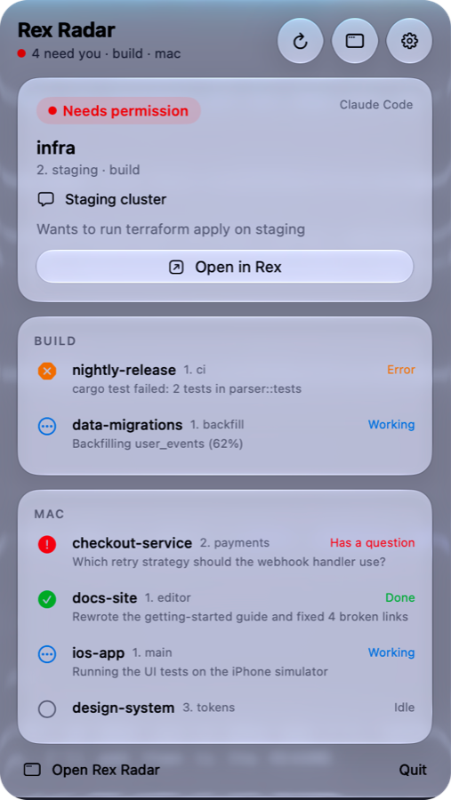
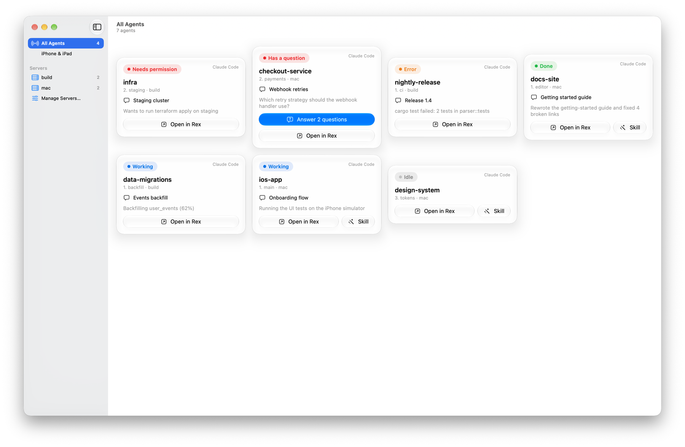
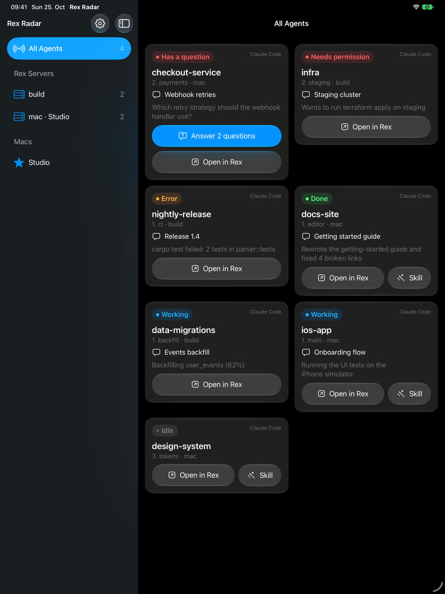
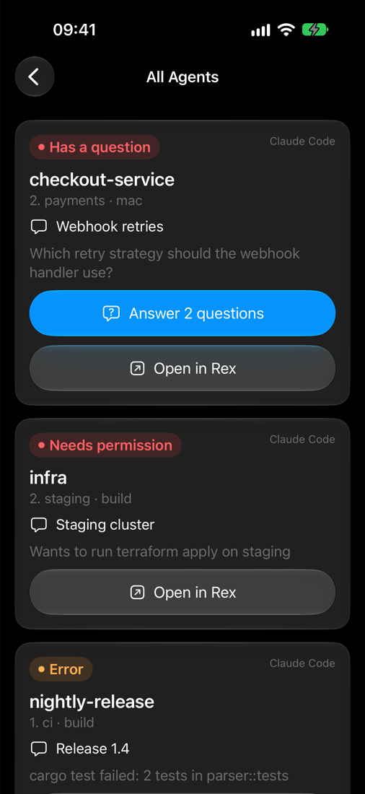
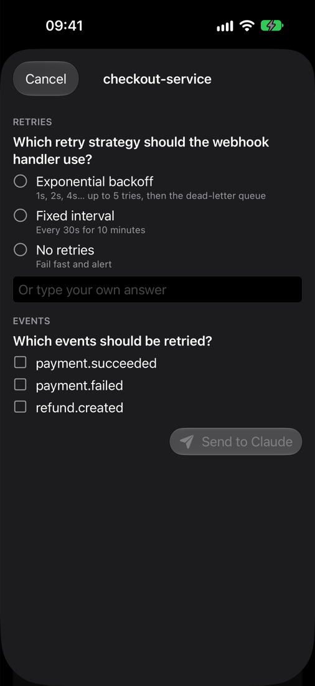
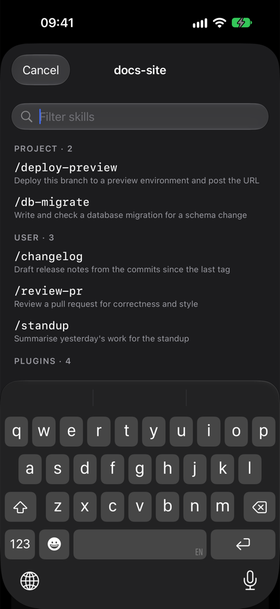
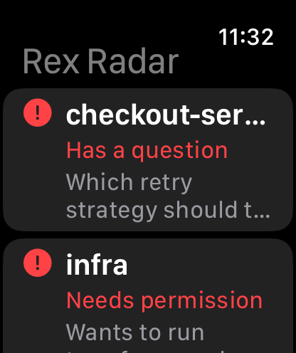

# Rex Radar

A glanceable view of the coding agents running in [Rex](https://www.superlogical.com/rex) terminal sessions,
across several Rex servers: a macOS menu bar app and desktop widget, an iPhone and iPad app with widgets, and an
Apple Watch app with complications. See which agent is blocked, done or working, jump to its pane in Rex, answer
its questions and send agents skills, from wherever you are.

> A community project, not affiliated with Superlogical. Rex is in beta and its API changes weekly, so things
> can break with a Rex update; what's been verified, and on which builds, is noted below.

<p align="center">
  
  
</p>
<p align="center">
  
</p>
<p align="center">
  
  
  
  
</p>

## Features

- **Every agent at a glance**, most urgent first: blocked, error, done, working, idle; with Claude's one-line
  summary and conversation topic.
- **Open in Rex**: click or tap an agent to switch your Mac's Rex app to its pane, on any of your Rex servers.
- **Answer agents' questions** (Claude Code's AskUserQuestion, Codex's and Antigravity's question forms) from
  the Mac, iPhone, iPad, watch or Apple TV.
- **Send skills**: pick any skill or slash command Claude Code, Codex or Antigravity offers in a pane (project,
  user and plugin), filtered as you type, and send it with arguments.
- **Widgets and complications** on the Mac desktop, Home and Lock Screen, and the watch face.
- **Apple TV**: a full-screen grid of your agents for the wall, paired by allowing it on the Mac.

## Requirements

- Rex (beta) on a Mac running macOS 26, with **Remote Control** on in the Rex app's settings.
- Claude Code 2.1.310 or later, which reports its status to Rex. Codex (Rex detects its status itself) and
  Antigravity (`agy`, reports its own) show up too. Other agents show up if they report
  [program status](https://www.superlogical.com/rex/docs/build/program-status).
- To build: Xcode 26 or later and [XcodeGen](https://github.com/yonaskolb/XcodeGen) (`brew install xcodegen`).
  For the widgets, the iOS app and the watch app, an Apple Development team (a free Personal Team works for your
  own devices).
- iOS/iPadOS 17 and watchOS 10 or later for the mobile apps.

## Getting started

There are no prebuilt releases yet: build it from source.

```sh
git clone https://github.com/hecspc/rex-radar && cd rex-radar/macos

# Mac app only (command-line tools, ad-hoc signed, no widget)
./bundle.sh --install

# Mac app and desktop widget, signed with your team
DEVELOPMENT_TEAM=<team id> BUNDLE_PREFIX=com.yourname scripts/build.sh --install
```

- Your team ID is the `OU` of your Apple Development certificate
  (`security find-certificate -c "Apple Development" -p | openssl x509 -noout -subject`).
- `BUNDLE_PREFIX` is the reverse-DNS prefix for every bundle ID and App Group. Bundle IDs belong to one team, so
  use your own (the default, `house.milapan`, only signs for the author).
- The app starts a watcher for this Mac's Rex server on launch. Add remote Rex servers in the window's
  **Manage Servers…** (they need to be hosts your Rex app is connected to).
- To answer Claude's question lists, install the hook in `hooks/claude-rex-questions` (needs `jq`); see
  [Answering questions](#answering-questions). Codex and Antigravity need nothing installed.

**iPhone, iPad and Apple Watch**: generate the project and build the `RexRadarMobile` scheme (the watch app is
embedded) to your device:

```sh
cd macos && xcodegen generate
xcodebuild -project RexRadar.xcodeproj -scheme RexRadarMobile -destination 'id=<device udid>' \
  -allowProvisioningUpdates DEVELOPMENT_TEAM=<team id> BUNDLE_PREFIX=com.yourname build
```

Or open `RexRadar.xcodeproj` in Xcode and run it there. Then pair: on the Mac open Rex Radar's window →
**Devices** and scan the QR code with the iPhone's Camera. The watch gets its pairing from the phone. The Apple
TV finds the Mac on the network and asks; allow it on the same page.

### Security

The Mac app serves its agents to your phone over plain HTTP on port 7298, with a random bearer token from the
pairing code. Anyone with the token can see your agents and open panes. An Apple TV gets the same token, only
after you choose Allow on the Mac; answering questions and sending skills
are off until you turn them on in Settings. Use it on a network you trust, ideally over
[Tailscale](https://tailscale.com), which encrypts it and lets the phone reach the Mac from anywhere.

## Contributing

Issues and pull requests are welcome. `CLAUDE.md` describes the architecture and conventions (it's written for
Claude Code, and works as well for people). There are no tests: say in a pull request how you checked the change,
and on which Rex and Claude Code builds. When Rex behaviour changes, record what you verified, with the date and
versions, in this README.

## License

[MIT](LICENSE)

The agent logos in `macos/Resources/AgentIcons.xcassets` are trademarks of their owners (Claude Code: Anthropic;
Codex: OpenAI; Antigravity: Google), used only to show which agent runs in a pane. They're rendered from
[lobehub/icons](https://github.com/lobehub/icons) (`@lobehub/icons-static-svg` 1.100.0, MIT) and aren't covered
by this project's licence.

# Design notes

## What it shows

A sidebar like Rex's own: servers → sessions → tabs → panes. Each pane running an agent shows:

- **Agent**: its logo, then its name: Claude Code, Codex and Antigravity (`Resources/AgentIcons.xcassets`); any
  other agent, and the SwiftPM build (no asset catalog), get a grey chip symbol instead.
- **State**: idle, working, blocked (permission, question or auth), done or error.
- **Summary**: one line about what the agent did or needs.
- **Unread**: done or blocked since you last looked.
- **Where**: session, tab, and the pane's label when it has one other than Rex's default `shell`
  (`2. agents › reviewer`), so several helpers in one tab stay distinguishable.

Ordered by urgency: blocked first, then done-unseen, then working.

## Servers and the main server

rex-radar connects to several Rex servers at once. One of them is the **main** server, the one whose Rex app you
sit in front of.

| Where you tap | Server of the tapped agent | What opens |
| --- | --- | --- |
| iOS | any | The tab in the **main** server's Rex app, not on the phone |
| macOS | local | The tab in the local Rex app |
| macOS | remote | The tab in the local Rex app, through its connection to that remote host |

On iOS rex-radar is a remote control: it shows everything and sends you to your desk.

## How it works

### Data: all from the Rex server API

The server describes its own API (`rex api list`, `rex api describe <method>`):

- `session.list`, `session.view`: sessions, windows (tabs), layouts, blocks (panes) and labels.
- `com.superlogical.terminal.program_status`: each pane's status records. Programs report them with
  [OSC 7501](https://www.superlogical.com/rex/docs/build/program-status).
- `com.superlogical.terminal.title`: the terminal title. Claude Code sets it to the conversation topic.
- Events (`rex.on` in Lua, or `rex events`): `terminal.program_status_changed`, window and session changes, so no
  polling.

**Claude Code reports its own status from 2.1.310 on.** Verified 2026-10-24: `idle` at start, `working` while it
runs, `done` with a summary in `msg` ("replied 'pong' as requested"). 2.1.283 reported nothing. Not yet verified:
`blocked` on a permission or question prompt.

**Rex detects Codex's status itself**, through the `rex __internal session-start --agent codex` SessionStart hook
Rex adds to `~/.codex/hooks.json`. Codex asks to trust new hooks at startup; untrusted, the pane reports nothing.
Verified 2026-10-25 with codex-cli 0.164.0: `idle` at start, `working`, `blocked` with `kind=permission` on a
command approval, then `done`, all with `app=codex` and never a `msg`. Codex's terminal title is
`<spinner> <topic> | <project>`, with `[ ! ] Action Required | ` in front while blocked; the topic strips both.

**Antigravity (`agy`) reports its own status**, with no Rex hook. Verified 2026-10-25 with agy 1.4.7: `idle` at
start, `working`, `blocked` with `kind=permission` and the command in `msg` ("Approve RunCommand: curl …"), then
`done` with the reply in `msg`, all with `app=antigravity`. It sets no terminal title, so the card shows `msg`.
Gemini CLI is deprecated in favour of it and was not tested.

Codex (in Plan mode) and Antigravity also report `blocked` with `kind=question` while they ask; see
[Answering questions](#answering-questions). Answering, permissions and skills work for all three.

### Opening a tab in the right app

Rex apps are clients of a server. A Mac app connected to a remote host is also a client *of that host*. To open
a tab in a given app, ask the server that holds the session to run `session.select` on that app's client:

```sh
rex -S <server> -C <client> do session.select session_id=<session> window_id=<tab>
```

- Needs **Remote Control** turned on in that Rex app's settings.
- For a remote agent opening in the main or local Mac app, that app must already have the remote host added.

### Connecting

Rex trusts callers by how they connect. The only safe remote access today is **Tailscale**: a server started with
`rex server start --tailscale`, or Tailscale Serve or a tailnet address on Linux. Any connection gets full control
of that server ([Remote Access](https://www.superlogical.com/rex/docs/linux/remote-access)). Rex Radar reads,
selects panes, and types into one only to answer a question or send a skill you chose, each behind a setting
for phones.

## Prototype

`watcher/rex-radar.lua` publishes one server's agent panes; `bin/rex-radar` reads every server's snapshot.

```sh
# one watcher per server; leave it running in a Rex pane
rex do watcher/rex-radar.lua --all source=mac
rex -S build do watcher/rex-radar.lua --all source=build server=build

bin/rex-radar                         # every agent pane, most urgent first
bin/rex-radar --json                  # the same as JSON
bin/rex-radar open 2                  # show row 2 in the server's Rex apps
bin/rex-radar open 2 --client my-mac   # only in the app labelled my-mac (the main Mac)
```

```
1  ✓ done      mac · rex-config-review · 3. radar-test
       init.lua: tmux-style keybinds, rexurrect restore, loads rexdiff
```

- Snapshots: `~/.local/state/rex-radar/<source>.json` (`REX_RADAR_DIR`), replaced atomically on every change
  (debounced 0.3 s) and every 15 s. A snapshot older than two heartbeats is shown as stale.
- A row is a pane with at least one OSC 7501 record; its root record speaks for it (else the most urgent).
- `open` calls `session.focus_block`, then `client.perform` → `session.select` on the app clients of the pane's
  server. For a remote pane it goes through `rex -S <server>`, so the Mac app must have that host added.

Verified 2026-10-24 on Rex build 1408 with Claude Code 2.1.310: idle → working → done with the summary, a session
rename picked up live, and `open` switching the Mac app to the pane's tab. Not yet tried: a second server.

### macOS app and widget

`macos/` is a SwiftUI menu bar app with a window and a desktop widget, over the same snapshots.

```sh
DEVELOPMENT_TEAM=<team id> macos/scripts/build.sh --install   # app + widget, Xcode, signed
macos/bundle.sh --install                                     # app only, command-line tools, ad-hoc signed
```

- **Menu bar**: the app icon's dino and radar as a one-ink template glyph (`MenuIcon.swift`); a blip and a count
  when agents can't go on without you (blocked or error; done agents aren't counted).
- **Panel** (Liquid Glass): the most urgent agent as a card with **Open in Rex** and **Skill**, the others in a card
  per server (right-click one for **Send Skill…**). Opening a pane closes the panel.
- **Window**: a server sidebar and a card per agent.
- **Dock and menu bar**: Settings → **Show Rex Radar in** picks the Dock, the menu bar, or both (the default).
  Clicking the Dock icon opens the window; without the menu bar icon the window also opens at launch.
- **Widget** (small, medium, large): agents by urgency; tap one to open it in Rex (`rexradar://open?id=…`).
  The sandboxed widget can't read the snapshots, so the app copies the merged rows into the App Group
  `<team>.house.milapan.rex-radar` and reloads the widget when they change.
- **Open in Rex** switches the Rex app labelled with this Mac's name (`defaults write house.milapan.rex-radar
  clientLabel <label>` to change it), then brings Rex to the front.
- The team ID is the `OU` of your Apple Development certificate. A free Personal Team is enough to run it on your
  own Mac.

### iPhone and iPad

`macos/Sources/RexRadarMobile` is one SwiftUI app for both (iOS/iPadOS 17+; Liquid Glass on 26+, frosted material before): a server sidebar beside agent cards on iPad, a stack on
iPhone, with the same glass cards. It talks to the Mac app, which is the hub (the "main" server): taps on the
phone open agents in the Mac's Rex.

- **Hub** (in the Mac app): HTTP on port 7298, `GET /v1/agents`, `POST /v1/open?id=…`, `POST /v1/answer?id=…`,
  `POST /v1/permission?id=…`, `GET /v1/skills?id=…` and `POST /v1/skill?id=…`, every request with
  `Authorization: Bearer <token>`; advertised over Bonjour as `_rexradar._tcp`.
- **Pairing**: the Mac window's **Devices** page shows a QR code per address (Tailscale first). Scan it with
  the Camera app: the `rexradar://pair?host=…&token=…` link opens the app and pairs it. The token goes to the
  Keychain. A form takes the address and token by hand.
- **Local network**: iOS asks once to allow local network access; the app can't reach the Mac on the LAN until it's
  allowed. Over Tailscale the hub is reachable from anywhere, encrypted.
- **Widget** (Home Screen small/medium/large, Lock Screen circular/rectangular/inline): the app shares its
  paired Macs (with their tokens) and agents in the App Group `group.house.milapan.rex-radar`, and the widget
  fetches fresh agents itself every few minutes, since the app is often not running. Tap one to open it on the
  main Mac.
- **Orientation**: portrait and landscape on iPhone and iPad; cards reflow into as many columns as fit, and the
  iPad sidebar sits beside them in landscape and slides over in portrait.
- Verified 2026-10-25 on an iPhone Air (iOS 27), paired by QR over the local network after allowing local
  network access.
- Verified 2026-10-25 on an iPad Pro 10.5" (2017, iPadOS 17.7.11), the oldest supported release, without Liquid
  Glass.
- Builds with the same project: `xcodebuild -scheme RexRadarMobile …`. In a simulator, pair without the URL prompt
  with `SIMCTL_CHILD_REXRADAR_PAIR='rexradar://pair?…' xcrun simctl launch <sim> house.milapan.rex-radar.ios`.

### Apple Watch

`macos/Sources/RexRadarWatch` is a watchOS app (watchOS 10+) inside the iOS app, with complications.

- **Pairing**: none on the watch. The iPhone app sends its paired Macs (with tokens, main one marked) as the
  WatchConnectivity application context whenever they change, when the session activates and when the watch app is
  installed. The watch reuses the iOS `HubClient`, so it fetches, opens and answers exactly like the phone; watchOS
  routes its requests through the iPhone when it's nearby.
- **App**: agents most urgent first; an agent's page shows its summary, **Answer** (options only, no free text)
  and **Open on Mac**.
- **Complications**: circular (count), rectangular (most urgent agent), corner and inline, from the watch's App Group
  `group.house.milapan.rex-radar.watch`.
- Verified 2026-10-25 on an Apple Watch Series 10 (watchOS 27.0.1): list, agent page and answering. Install it
  on a real watch after pairing it in Xcode 27's DeviceHub (+ → Pair Nearby Device) with Developer Mode on.

### Apple TV

`macos/Sources/RexRadarTV` is a tvOS app (tvOS 17+; Liquid Glass on 26+): every agent from every paired Mac as
a grid of cards, most urgent first, for a screen on the wall. Select a card to open it in Rex on the main Mac. It
reuses the iOS `HubClient`, like the watch. Skills aren't offered.

- **Focus**: each agent is one tvOS card (it lifts under focus), and the header and grid are separate focus
  sections, so Down from Settings reaches the cards. Focus starts on the first agent.
- **Answering**: a card whose questions can be answered from here (the Mac's **Let iPhone & iPad answer**
  setting) says **Answer N questions**, and Select shows them full screen: options only, no free text. Picking an
  option of a single-choice question moves focus to the next question, then to **Send**; **Open in Rex Instead**
  is below it. Verified 2026-10-25 in the simulator by answering a two-question list from the TV.

- **Pairing**: the Apple TV has no camera for the QR code. It lists the Macs advertising `_rexradar._tcp` over
  Bonjour (or takes an address, for a Mac on Tailscale), resolves the chosen one to its IPv4 address, and asks it:
  `POST /v1/pair` (body `{"name"}`, no token) returns an id and a four-digit code. The Mac brings its window to
  **Devices**, where the request shows the same code with **Allow** and **Deny**; the TV polls
  `GET /v1/pair?id=…` until it gets the token (once) or a denial. Requests lapse after two minutes, and at most
  three wait at a time.
- **Keep the Screen On** (Settings, on by default): no screen saver or sleep while the app is open.
- **Icon**: a layered icon (night blue behind, radar and dino in front) and Top Shelf images, drawn by
  `make-icon.swift` into `macos/Resources/TVAssets.xcassets`.
- Builds with `xcodebuild -scheme RexRadarTV …`. In a simulator, which can't press the remote from the command
  line, `SIMCTL_CHILD_REXRADAR_PAIR_WITH=<Mac name> xcrun simctl launch <sim> house.milapan.rex-radar.tv` asks
  that Mac as soon as it's found, and `SIMCTL_CHILD_REXRADAR_SHOW_ANSWER=1` opens the first answerable agent's
  questions when they appear.
  Build it signed (ad hoc is enough, `CODE_SIGN_IDENTITY=-`): with `CODE_SIGNING_ALLOWED=NO` the app can't write
  to the Keychain, so it pairs but every request then gets a 401.
- Verified 2026-10-25 in the Apple TV 4K simulator (Xcode 27): Bonjour found the Mac, it was allowed on the Mac's
  Devices page, and the grid showed the Mac's agents.
- **A real Apple TV**: pair it in Xcode's Device Hub (TV: Settings → Remotes and Devices → Remote App and
  Devices), then build for it with `-allowProvisioningUpdates -allowProvisioningDeviceRegistration
  DEVELOPMENT_TEAM=<team>` and install with `xcrun devicectl device install app`. At run time the TV only needs
  TCP 7298 to the Mac and Bonjour reflected (Avahi) across the VLANs. Pair the app itself with the Mac on its
  usual network, because it saves the Mac's IPv4 address.
  Verified 2026-10-25 on an Apple TV 4K (2nd generation), tvOS 27.0, on a different VLAN from the Mac.
  The same day it answered a two-question list whose first question Claude had wrapped over five lines.
  The pane check compares the screen without line breaks or the `│` border, because the wrapped question
  never matched as one line and the Mac refused the answer.
- **Installing on a TV on another VLAN**: Device Hub pairs, but shows the TV as unavailable, even with the
  firewall open both ways and Bonjour reflected. The pairing daemon checks the device with ARP before it
  connects (`remotepairingd`: "CUNetLinkManager reported the device as unavailable using ARP"), and ARP never
  crosses subnets. A host route through the Mac's interface makes the TV count as on-link, while the traffic
  still goes through the router: `sudo route -n add -host <tv address> -interface en0`. To keep it across reboots
  and network changes, `sudo macos/scripts/device-route.sh install <tv address> en0 <start of the Mac's address,
  e.g. 10.0.10.>` installs a launch daemon that adds the route while the Mac is on that network and removes it
  elsewhere (`uninstall` removes it; `check` shows what it would do). Proxy ARP on the router isn't needed: the
  route alone passed the check with it off. Verified 2026-10-25 with Xcode 27 and tvOS 27.0, the TV on
  `10.0.50.0/24` and the Mac on `10.0.10.0/24`.

### Answering questions

When an agent asks a question list, Rex Radar shows it as a form (Mac panel and window, iPhone, iPad, Apple Watch
and Apple TV) and answers it by typing into the pane. Rex's status carries at most the first question, so the
whole list comes from the agent on this Mac: only panes on the Mac's own Rex server can be answered.

**Claude Code** (AskUserQuestion), as tested on Claude Code 2.1.310:

- a single-choice option's number selects it and moves on; free text is the number after the options, the text
  and Enter (single-choice only: a multi-select question doesn't take typed text);
- on a multi-select question numbers toggle and Tab moves on;
- a list ends on Claude's review screen, which must show exactly the chosen answers before `1` submits; a single
  single-choice question submits when picked.

Before typing, Rex must report the pane as blocked on a question and the screen must show the first question;
answers are validated (one per question, options in range, one short line of text). A mismatch at review leaves
the form open in Rex. Phones can answer only when **Settings → Let iPhone & iPad answer agents' questions** is
on (off by default): `POST /v1/answer?id=…` answers `403` otherwise.

`hooks/claude-rex-questions` saves the full question list per pane (Rex's status carries only the first
question). Register it in `~/.claude/settings.json`: `ask` on PreToolUse with matcher `AskUserQuestion`, `done` on
PostToolUse and PostToolUseFailure (same matcher), Stop and UserPromptSubmit (a cancelled list runs no post-tool
hook).

**Codex** (`request_user_input`), verified 2026-10-25 with codex-cli 0.164.0 (`Sources/RexRadar/AgentQuestions.swift`):

- Codex has the tool only in Plan mode (Shift+Tab): one to three single-choice questions, each with two or three
  options, to which its form adds "None of the above" with a note. There is no multi-select. Rex reports `blocked`,
  `kind=question`, `app=codex` and no `msg`. (`request_user_input_async`, which doesn't wait, isn't a form.)
- The form shows one question at a time ("Question 1/3 (3 unanswered)"). An option's number picks it and moves
  on; on the last question it submits them all, with no review screen. Free text is a note on "None of the
  above": Down to it, Tab, the text, Enter.
- Where the list comes from: the Codex TUI runs its threads in a shared `codex app-server` daemon, and hooks run
  in that daemon with the environment (`REX_BLOCK`) of whichever pane started it, so no hook can tell which pane
  asks, and the TUI process holds no thread file open. The call is in the thread's rollout,
  `~/.codex/sessions/YYYY/MM/DD/rollout-*.jsonl` (`$CODEX_HOME`), as a `function_call` named
  `request_user_input`, written just before Rex reports the question. Rex Radar reads the rollouts written since,
  takes the newest unanswered call (no `function_call_output` with its `call_id`) whose question the screen shows
  ("Question k/N" and that question's text), and prefers a rollout started in the pane's working directory.

**Antigravity** (`ask_question`), verified 2026-10-25 with agy 1.4.7 (tested in Plan mode):

- Questions with plain options, single or multiple choice, to which its form adds "Write-in...". Rex reports
  `blocked`, `kind=question`, `app=antigravity`, with the first question in `msg`.
- The form lists every question ("? …") above the current one ("Question 1/3: …"). On a single-choice question
  an option's number picks it and moves on; on a multi-select one numbers toggle and Enter moves on (with none
  ticked, it skips). Free text is the "Write-in..." number, the text and Enter. On the last question the pick or
  Enter submits them all, with no review screen.
- Where the list comes from: Antigravity has no hooks. Each conversation is a SQLite file,
  `~/.gemini/antigravity-cli/conversations/<id>.db`, which the `agy` process (Rex's `owner.pid`) keeps open. While
  it asks, the conversation's latest step is the call, and its payload holds the JSON arguments
  (`{"questions":[{"question","options","is_multi_select"}]}`); Rex's `msg` must equal the first question.

For both, before typing Rex must report the question and the screen must show "Question 1/N" with the first
question (if you've already moved on in Rex, it refuses: finish there); afterwards Rex must no longer report it.
Free text stays single-choice only, as for Claude. Test without clicking: `RexRadar --answer <block id>
'[{"options":[1]},{"text":"Teal"}]'`.

### Allowing permissions

When Claude Code, Codex or Antigravity waits on a permission (Rex: `blocked`, `kind=permission`), the card shows
what it asks, with **Allow** and **Deny** (Mac panel and window, iPhone, iPad, Apple Watch, and Select on Apple
TV). Allow presses `1`, the first option ("Yes", this once); Deny presses Esc. Verified 2026-10-25 on Claude Code
2.1.310, Codex 0.164.0 and Antigravity 1.4.7: all three put "1. Yes…" first and cancel on Esc, which leaves the
agent idle.

- What it asks is Rex's `msg` (Claude Code: "approve Bash: …", Antigravity: "Approve RunCommand: …"). Codex sends
  no `msg`, so the Mac reads the prompt off the screen, once per status update: the lines above "1. Yes", up to
  its "• Running …" line, rejoined where a narrow pane wrapped them.
- Before pressing a key, Rex must still report a permission, the screen must show "1. Yes", and the prompt must
  equal the one the device showed (the phone sends it back in `PermissionReply`). Afterwards the prompt must be
  gone, else it says so.
- Phones can do it only when **Settings → Let iPhone & iPad allow or deny permissions** is on (off by default):
  `POST /v1/permission?id=…` answers `403` otherwise. Unlike questions, it works for remote servers too: no hook
  file is needed.
- Test without clicking: `RexRadar --decide <block id> allow|deny`.

### Sending skills

Any Claude Code, Codex or Antigravity pane on the Mac's own Rex server can be sent a skill from the Mac panel, the
window, iPhone and iPad (not the watch or Apple TV): **Skill** on its card opens a picker that filters as you type
(every word must appear in the name or description; Return picks the first match), grouped **Project**, **User**
and **Plugins**, then takes optional arguments.

- **Catalog** (`SkillCatalog.swift`): what the agent's menu lists, read from the Mac's disk for the pane's working
  directory (the foreground process's `cwd` from `com.superlogical.terminal.process`). A name found in more than
  one place counts once, from the first place below. Built-in commands and skills that don't live on disk aren't
  listed.
  - **Claude Code**, `/name`. Project: `.claude/skills/*/SKILL.md` and `.claude/commands/**/*.md` in that directory
    and its parents below `~`, nearest first. User: the same under `~/.claude`. Plugins: `skills/` and `commands/`
    of each plugin in `~/.claude/plugins/installed_plugins.json` that `enabledPlugins` turns on (user, then project
    settings), or that's managed and not turned off, as `/<plugin>:<name>`. `user-invocable: false` skills are
    left out.
  - **Codex**, `$name` (skills only, no commands). Project: `.agents/skills/*/SKILL.md` and `.codex/skills/*/SKILL.md`
    in that directory and its parents up to the repository root (the folder with `.git`), not above. User:
    `~/.agents/skills`, `~/.codex/skills` and its bundled `~/.codex/skills/.system`. Plugins: the newest cached
    version of each installed plugin, `~/.codex/plugins/cache/<marketplace>/<plugin>/<version>/skills`, as
    `$<plugin>:<name>`, unless `config.toml` has `enabled = false` under `[plugins."<plugin>@<marketplace>"]`.
    Codex's menu shows a skill's display name (`agents/openai.yaml`) and inserts `$name`; the picker shows `$name`.
  - **Antigravity**, `/name`. Project: `skills/*/SKILL.md` in `.agents`, `.agent`, `_agents` or `_agent`, in that
    directory and its parents up to the repository root. User: `~/.gemini/config/skills`. Plugins: `plugins/<dir>/`
    in those same folders with a `plugin.json` manifest, as `/<plugin>:<name>`, unless `~/.gemini/config/config.json`
    has `plugins.<dir>.enabled: false` (what `agy plugin disable` writes), or has no entry and the manifest says
    `"disabled": true`. `disable-slash-command: true` skills are left out, and so are the built-in skills
    in `~/.gemini/antigravity-cli/builtin/skills`: agy's menu offers only some of them (on 1.4.7,
    `agy-customizations` and `antigravity-guide`) and nothing on disk says which. Not offered: `.gemini/skills`,
    `~/.agents/skills` and legacy `.agents/workflows`.
- **Sending**: types the skill and its arguments into the pane, then the key that submits it. Refused when Rex
  reports any blocked record (a question or permission prompt would take the keys), when the name isn't in the
  pane's catalog, or when the arguments aren't one line of at most 500 characters. Whatever is already typed at the
  prompt stays and comes first. Verified 2026-10-25 with temporary "pong" skills in each location above:
  - Claude Code 2.1.310: `/name arguments`, then Enter. One Enter submits with or without arguments, even while
    the slash menu is open; while Claude works the message queues.
  - Codex 0.164.0: `$name arguments` (`$name ` with a trailing space when there are none), then Tab. Enter would
    only insert the highlighted entry while the `$` menu is open, which a bare name leaves open and a space closes;
    and while Codex works, Enter steers the running turn (the skill replaced the reply in progress) while Tab
    queues it as a follow-up. Tab submits right away when Codex is idle. Codex attaches the skill as a `<skill>`
    block (seen in its session log), plugin skills too (`$plugin-management:plugin-management`).
  - Antigravity 1.4.7: `/name arguments`, then Enter, which submits even while the slash menu is open; while agy
    works the message queues and runs after the reply.
- **Phones**: only when **Settings → Let iPhone & iPad send skills to agents** is on (off by default):
  `GET /v1/skills?id=…` and `POST /v1/skill?id=…` (body `{"name", "arguments"}`) answer `403` otherwise. Each
  `Skill` carries its `sigil` (`/` or `$`); a Mac without it means `/`. Remote servers aren't offered: their skills
  are on another machine's disk.
- Test without clicking: `RexRadar --skill <block id> list` prints the pane's catalog, and
  `RexRadar --skill <block id> '{"name": "…", "arguments": "…"}'` sends one.

### App icon

`macos/scripts/make-icon.swift` draws the icon (our own dino in front of a radar, on a night-blue tile) into
`macos/Resources/Assets.xcassets`; run it from `macos/` after changing the drawing.

## Risks

- **The transport isn't public.** The API methods are documented; the protocol the `rex` CLI speaks to the server
  (`rex.control.v1` over the server's socket or HTTP) is not. A native Swift client would have to follow a beta that
  changes weekly. Going through `rex` (CLI or Lua) avoids that.
- **Overlap with Rex.** Rex's own iOS app and the Mac app's Activity view already show per-pane status and navigate
  on tap, for one host at a time. What rex-radar adds: several servers in one view, main-server routing, and the
  summary up front.
- **Auth.** Until Rex has its own authentication, everything rides on Tailscale ACLs.

## Related

- Rex docs: [Server API](https://www.superlogical.com/rex/docs/automate/server-api),
  [Program Status Protocol](https://www.superlogical.com/rex/docs/build/program-status),
  [Lua events](https://www.superlogical.com/rex/docs/automate/lua-events)
- [rexurrect](https://github.com/cemcatik/rexurrect): session restore; holds each pane's `claude --resume <id>`
